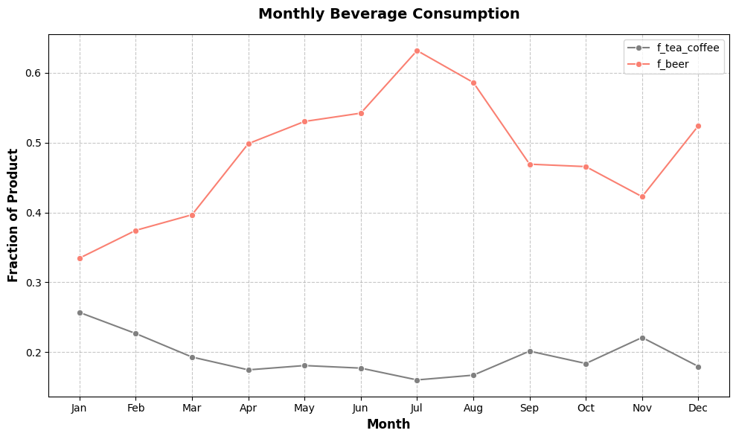
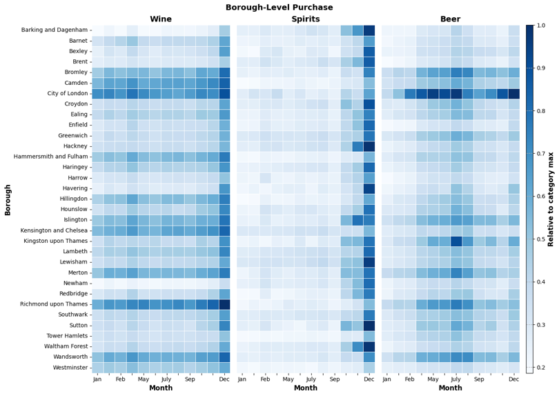
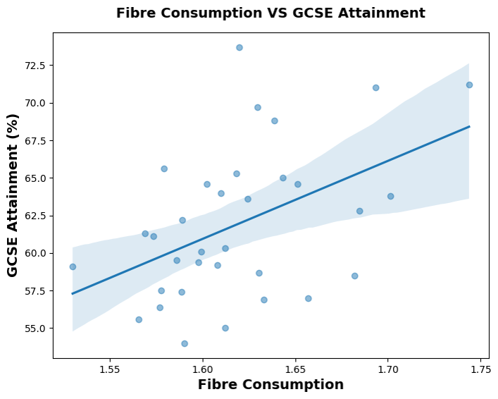
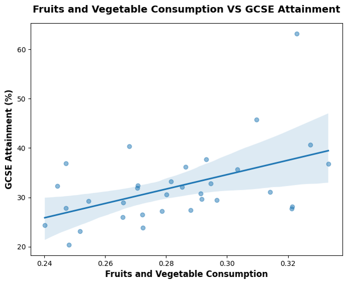
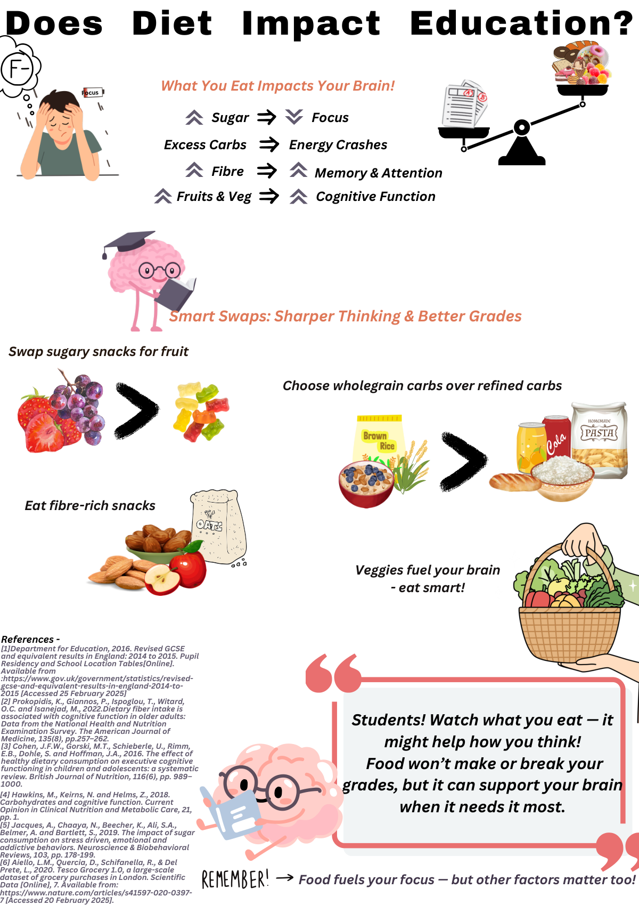

# Consumer Behaviour Analysis — Tesco Grocery 1.0

A Python-based exploratory data analysis project investigating seasonal grocery purchasing patterns, regional consumer behaviour and area-level associations between nutritional purchasing indicators and educational attainment across Greater London.

**University of Bath | MSc Data Science | Applied Data Science**

## Project Overview

This project explores the Tesco Grocery 1.0 dataset alongside UK government educational attainment statistics to identify purchasing trends and investigate associations between grocery purchasing indicators and educational attainment.

## Datasets

The original Tesco Grocery 1.0 dataset covers:

- 420 million transactions
- 1.6 million Tesco Clubcard users
- 411 Tesco stores
- 17 food categories
- Grocery purchases across Greater London during 2015

These figures describe the original dataset. This project analyses geographically aggregated monthly and annual grocery statistics, not individual transactions.

**Data sources:**
- [Tesco Grocery 1.0 — Scientific Data](https://www.nature.com/articles/s41597-020-0397-7)
- [Department for Education — GCSE Results 2014–2015](https://www.gov.uk/government/statistics/revised-gcse-and-equivalent-results-in-england-2014-to-2015)

## Methodology

- Exploratory data analysis
- Data preprocessing and dataset integration
- Temporal and geographical purchasing analysis
- Literature-driven hypothesis formulation
- Correlation analysis
- Statistical visualisation
- Data storytelling for technical and non-technical audiences

## Key Findings

### Seasonal Purchasing Patterns

- Beer purchases increased during warmer months, while tea and coffee purchases were generally higher during colder months.
- Beer and tea/coffee purchasing patterns exhibited a negative correlation of −0.49.
- Purchases of wine and spirits peaked in December.
- Purchasing behaviour varied across London boroughs.



*Monthly beverage purchasing indicators show contrasting seasonal patterns between tea/coffee and beer.*



*Regional and seasonal purchasing patterns, normalised relative to each product category's maximum.*

### Grocery Purchasing and Educational Attainment

| Purchasing indicator | Educational outcome | Pearson r |
|---|---|---:|
| Fruits and vegetables | GCSE | +0.330 |
| Fruits and vegetables | EBacc | +0.490 |
| Fibre | GCSE | +0.470 |
| Poultry | GCSE | −0.574 |
| Red meat | GCSE | −0.491 |
| Carbohydrates | EBacc | −0.474 |
| Sugar | EBacc | −0.216 |
| Energy | EBacc | −0.462 |

GCSE attainment refers to the percentage of pupils achieving five or more A*–C grades including English and mathematics; EBacc attainment refers to the percentage achieving the English Baccalaureate.

These findings represent exploratory borough-level associations rather than causal relationships. Confidence intervals and formal significance tests have not been reported.

<p align="center">
  
  
</p>

*Scatter plots from the original analysis showing positive area-level associations. The attainment measures and purchase indicators should not be interpreted as individual dietary or causal effects.*

## Communicating Findings to a Non-Technical Audience

An infographic designed to communicate the exploratory findings and related nutritional research to students in an accessible format.

<p align="center">
  
</p>

## Potential Business Applications

| Finding | Potential retail action |
|---|---|
| Contrasting seasonal beer and tea/coffee patterns | Investigate seasonal replenishment and promotional calendars. |
| December peaks in wine and spirits | Evaluate festive stock planning and campaign timing. |
| Borough-level variation in purchasing | Explore local assortment and region-specific promotions. |

These are hypotheses for commercial decision-making, not validated interventions or sales forecasts. Current sales, pricing, weather and promotional data would be needed before implementing these recommendations.

## Limitations

- Selection bias associated with Tesco Clubcard membership.
- Limited coverage of purchases from other retailers.
- Temporal differences between grocery and educational datasets.
- Potential socioeconomic confounding variables.
- Grocery purchases do not necessarily reflect individual dietary consumption.
- Correlation does not imply causation.

## Repository Contents

| Resource | Description |
|---|---|
| [tesco_retail_analysis.ipynb](tesco_retail_analysis.ipynb) | Seasonal and geographical grocery purchasing analysis. |
| [food_education_analysis.ipynb](food_education_analysis.ipynb) | Borough-level grocery and educational data integration, Pearson correlations and visualisations. |
| [data/](data/) | Aggregated grocery purchasing data, educational attainment data and geographic lookup files. |
| [images/](images/) | Selected charts and the original student-facing infographic. |

## Getting Started

Use Python 3 and Jupyter Notebook. Clone the repository and open the notebooks from the repository root so that relative data paths resolve correctly.

```bash
git clone https://github.com/EnidFerns/Consumer-Behaviour-Analysis-Tesco.git
cd Consumer-Behaviour-Analysis-Tesco
python -m pip install jupyter pandas matplotlib seaborn openpyxl
jupyter notebook
```

The packages above cover the food and education notebook; additional dependencies may be required for the retail notebook. Run the cells in order. The environment is not version-pinned, and a fresh end-to-end run has not been verified.

## Future Work

- Incorporate socioeconomic indicators.
- Report sample sizes, confidence intervals and sensitivity to outliers; investigate potential confounding variables and multiple comparisons.
- Develop an interactive dashboard for regional and seasonal purchasing analysis.
